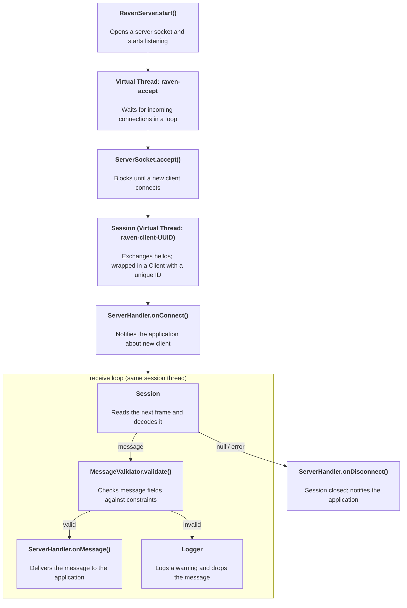
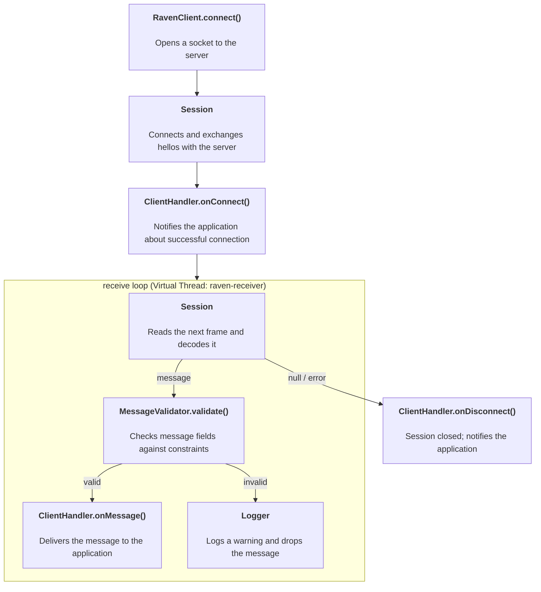
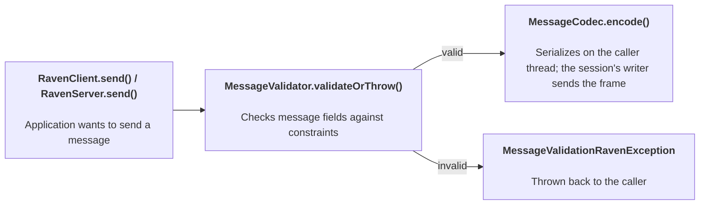

# Raven

Raven is a lightweight TCP networking framework for Java. It provides a pure Java transport layer and optional Spring integration with annotation-based message routing.

Named after messenger ravens — they carry your messages reliably.
Dedicated to my friend — the best 3D artist I know: https://www.deviantart.com/rav3nway

## Features

- Pure Java TCP transport (no Spring required)
- Virtual threads for scalable I/O
- Length-prefixed frames; Java serialization with a deserialization filter by default, or your own `MessageCodec`
- Annotation-based message dispatch for Spring applications
- Hierarchy-aware routing: a handler for a (possibly abstract) base class receives all its subclasses
- Separate server and client routers with signature validation at startup
- Zero-configuration Spring auto-setup via properties

## Modules

| Module                | Description                                                                                         |
|-----------------------|----------------------------------------------------------------------------------------------------------------|
| `raven-core`          | Pure Java transport: `RavenServer`, `RavenClient`, `Message`, `Client` (interface), `MessageCodec`, validation |
| `raven-spring-core`   | Spring base: `AbstractMessageRouter`                                                                |
| `raven-spring-server` | Server-side router + annotations (`@SubscribeMessage`, `@SubscribeConnect`, `@SubscribeDisconnect`) |
| `raven-spring-client` | Client-side router + annotations (`@SubscribeMessage`, `@SubscribeConnect`, `@SubscribeDisconnect`) |

## Quick Start

### 1. Define a message

```java
@SuperBuilder
public final class PingMessage extends Message {
}

@Getter
@SuperBuilder
public final class PongMessage extends Message {
    private final long serverTime;
}
```

### 2. Server (Spring Boot)

Add dependency:
```xml
<dependency>
    <groupId>io.github.trimax</groupId>
    <artifactId>raven-spring-server</artifactId>
    <version>1.5.0</version>
</dependency>
```

Import the autoconfiguration:
```java
@SpringBootApplication
@Import(RavenServerAutoConfiguration.class)
public class ServerApp { }
```

Configure:
```properties
raven.server.port=9090

# Optional: listen on one address only, e.g. 127.0.0.1 (default: all local addresses)
raven.server.bind-address=127.0.0.1

# Optional: outgoing messages queued per client before send() applies back-pressure (default 1024)
raven.server.send-queue-capacity=1024

# Optional: how long send() waits for queue space before disconnecting a stalled client (default 5s)
raven.server.send-timeout=5s

# Optional: how long a new connection may take to complete the handshake before it is dropped (default 5s)
raven.server.handshake-timeout=5s

# Optional: connections served at once, handshakes included; further connections are closed at once (default 1024)
raven.server.max-connections=1024

# Optional: largest serialized message, e.g. 512KB or 16MB (binary units); send() rejects larger ones and a peer announcing one is disconnected (default 16MB)
raven.server.max-message-size=16MB

# Optional: packages whose plain classes the default codec may deserialize, with their subpackages (default: none);
# "*" trusts every class, only for trusted networks. Ignored if a MessageCodec bean exists. See "Message Field Types"
raven.server.trusted-packages=com.example.dto,org.acme

# Optional: disconnect a client that sends nothing for this long (default 0 = off). There is no heartbeat,
# so a healthy client that stays silent this long is disconnected too
raven.server.idle-timeout=5m
```

Write a handler:
```java
@Slf4j
@Component
@RequiredArgsConstructor
public final class PingHandler {
    private final RavenServer server;

    @SubscribeMessage(PingMessage.class)
    public void onPing(Client sender, PingMessage message) {
        server.send(PongMessage.builder().serverTime(System.currentTimeMillis()).build(), sender.getId());
    }

    @SubscribeConnect
    public void onConnect(Client client) {
        log.info("Client connected: {}", client.getId());
    }
}
```

### 3. Client (Spring Boot)

Add dependency:
```xml
<dependency>
    <groupId>io.github.trimax</groupId>
    <artifactId>raven-spring-client</artifactId>
    <version>1.5.0</version>
</dependency>
```

Import the autoconfiguration:
```java
@SpringBootApplication
@Import(RavenClientAutoConfiguration.class)
public class ClientApp { }
```

Configure:
```properties
raven.client.host=localhost
raven.client.port=9090

# Optional: limit for opening the connection and completing the handshake (default 10s)
raven.client.connect-timeout=10s

# Optional: outgoing messages queued before send() applies back-pressure (default 1024)
raven.client.send-queue-capacity=1024

# Optional: how long send() waits for queue space before disconnecting (default 5s)
raven.client.send-timeout=5s

# Optional: largest serialized message, e.g. 512KB or 16MB (default 16MB)
raven.client.max-message-size=16MB

# Optional: packages whose plain classes the default codec may deserialize, with their subpackages (default: none);
# "*" trusts every class, only for trusted networks. Ignored if a MessageCodec bean exists. See "Message Field Types"
raven.client.trusted-packages=com.example.dto,org.acme

# Optional: disconnect if the server sends nothing for this long (default 0 = off). There is no heartbeat,
# so a healthy but silent connection is closed too
raven.client.idle-timeout=5m
```

Write a handler:
```java
@Slf4j
@Component
public final class PongHandler {

    @SubscribeMessage(PongMessage.class)
    public void onPong(PongMessage message) {
        log.info("Server time: {}", message.getServerTime());
    }

    @SubscribeConnect
    public void onConnect() {
        log.info("Connected to server");
    }
}
```

### 4. Without Spring (pure Java)

Add dependency (it brings `slf4j-api` and `commons-io`):
```xml
<dependency>
    <groupId>io.github.trimax</groupId>
    <artifactId>raven-core</artifactId>
    <version>1.5.0</version>
</dependency>
```

```java
// The handlers refer to the server and the client, so hold them in references set after construction
final var server = new AtomicReference<RavenServer>();
server.set(new RavenServer(RavenServerConfiguration.builder()
    .port(9090)
    .handler(new ServerHandler() {
        public void onConnect(Client client) { }
        public void onDisconnect(Client client) { }
        public void onMessage(Client sender, Message message) {
            server.get().send(PongMessage.builder().serverTime(System.currentTimeMillis()).build(), sender.getId());
        }
    })
    .interceptors(List.of((sender, message) -> true)) // e.g. reject unauthenticated messages
    .build()));
server.get().start();

final var client = new AtomicReference<RavenClient>();
client.set(new RavenClient(RavenClientConfiguration.builder()
    .host("localhost")
    .port(9090)
    .handler(new ClientHandler() {
        public void onConnect() { client.get().send(PingMessage.builder().build()); }
        public void onDisconnect() { }
        public void onMessage(Message message) { }
    })
    .build()));
client.get().connect();
```

## Send API

```java
// Broadcast to all connected clients
server.broadcast(message);

// Send a message to specific client(s)
server.send(message, clientId);
server.send(message, clientA, clientB);
server.send(message, Set.of(clientA, clientB));

// Client to server
client.send(message);
```

Sends are asynchronous: each connection has a queue (`sendQueueCapacity`, default 1024) drained by its own writer
thread. When the queue is full, `send()` waits up to `sendTimeout` (default 5s) per recipient and then disconnects
that stalled peer. Write errors close the connection instead of being thrown; messages still queued when a
connection closes are dropped. `server.send(message)` without recipients sends nothing — use `broadcast()`.
Sending on a disconnected client or a stopped server logs a warning and drops the message.

## Threading and Lifecycle

- All callbacks of one connection run on that connection's own virtual thread, in order: `onConnect`, then
  `onMessage` for each received message, then `onDisconnect`. `onDisconnect` runs exactly once for every
  `onConnect` that returned normally.
- `connect()`, `disconnect()` and `stop()` return once the corresponding callbacks have run (`stop()` waits for the
  `onDisconnect` of every client). Called from inside a Raven callback, they return without waiting.
- A received message passes validation, then the interceptors (in list order; the first that returns `false` or
  throws stops it), then the handler.
- A `ServerHandler` / `ClientHandler` callback that throws closes its connection; an `onConnect` that throws gets no
  `onDisconnect`. Spring `@Subscribe*` methods are isolated: an exception is logged and the other handlers still run.
- `connect()` does not throw: a failed attempt is logged and `isConnected()` stays `false`. There is no automatic
  reconnect (the Spring client connects once at startup); call `connect()` again yourself.

## Wire Format

Each side of a connection first sends a hello (the bytes `RAVN` and the protocol version, an `int`, currently 2;
bounded by `handshake-timeout` on the server and `connect-timeout` on the client),
then every message travels as one frame: its length as an `int`, followed by the encoded message. A peer whose hello
does not match, or that announces a frame larger than `maxMessageSize`, is disconnected. This format is **not**
compatible with Raven 1.4.x, which wrote one long Java object stream: server and clients must be upgraded together.

Messages are encoded by the configured `MessageCodec` (`RavenServerConfiguration.builder().codec(...)`, or a
`MessageCodec` bean with the Spring autoconfiguration). The default `JavaSerializationCodec` writes each message as a
self-contained Java serialization stream and reads it through commons-io's `ValidatingObjectInputStream` and a
deserialization filter, which only admit `Message` subclasses, records, enums, a fixed set of JDK value types and
collections, and the classes of trusted packages (see "Message Field Types").

`send()` and `broadcast()` encode the message on the calling thread before they return, so a message changed after
the call is sent as it was. A message that cannot be serialized, or is larger than `maxMessageSize`, makes them
throw `IllegalArgumentException`; `broadcast()` encodes once and shares the bytes among all recipients.

## Handler Signatures

### Server-side (`raven-spring-server`)

```java
@SubscribeMessage(MyMessage.class)
void method(Client sender, MyMessage message)

@SubscribeConnect
void method(Client client)

@SubscribeDisconnect
void method(Client client)
```

### Client-side (`raven-spring-client`)

```java
@SubscribeMessage(MyMessage.class)
void method(MyMessage message)

@SubscribeConnect
void method()

@SubscribeDisconnect
void method()
```

The message parameter must be the annotated type or one of its supertypes (e.g. `@SubscribeMessage(MyMessage.class) void method(Message message)` is valid). A parameter of a *subtype* of the annotated type is rejected at startup, because such a handler would also receive sibling subclasses.

## Message Hierarchy Routing

`@SubscribeMessage` accepts any subclass of `Message`, including abstract ones. A handler receives messages of the annotated type **and of all its subclasses**. This lets one handler cover a whole family of messages:

```java
@Getter
@SuperBuilder(toBuilder = true)
public abstract class GameRequest extends Message {
    @NotNull
    private final UUID gameId;
}

@Getter
@SuperBuilder(toBuilder = true)
public final class OrderPlaceRequest extends GameRequest {
    @NotNull
    private final UUID territoryId;
}

@Component
public final class GameRequestHandler {
    @SubscribeMessage(GameRequest.class)
    public void onGameRequest(Client sender, GameRequest request) {
        // receives OrderPlaceRequest and every other GameRequest subclass
    }
}
```

### Invocation order

For an incoming message, Raven walks the superclass chain of its concrete class and invokes handlers level by level:

1. handlers registered for the concrete class (e.g. `OrderPlaceRequest`);
2. handlers registered for each superclass, from the nearest one upward (e.g. `GameRequest`);
3. handlers registered for `Message` (catch-all), always last.

Within one level, handlers run in registration order. Each handler method is invoked at most once per message. Handlers registered for a subclass never receive messages of a sibling subclass. Only the superclass chain is considered; interfaces are not.

The resolved handler list is computed once per concrete message class and cached. The cache is invalidated when a handler is registered later (e.g. by a lazily initialized bean).

At startup the router logs every registered type, including abstract base classes:

```
MessageRouter: 3 message type(s), 0 connect handler(s), 0 disconnect handler(s)
  GameRequest -> 1 handler(s)
  Message -> 1 handler(s)
  OrderPlaceRequest -> 1 handler(s)
```

### Abstract intermediate classes

- **Validation**: constraint annotations on fields declared in abstract superclasses are validated together with the fields of the concrete class.
- **Serialization**: messages use Java serialization, so the fields of every class in the chain are transmitted and the concrete type is restored on the receiving side. Lombok `@SuperBuilder` and `final` fields work as usual.
- Declare an explicit `serialVersionUID` in the intermediate class as well. Otherwise, the client and the server may compute different values if they are built separately, and deserialization fails with `InvalidClassException`.

## Message Field Types

The peer is untrusted, so the default codec deserializes only these types; anything else closes the connection
as a protocol violation:

- `Message` subclasses, also nested in other messages
- **records** (`implements Serializable`), e.g. DTOs carried inside messages. Records are always allowed: the JVM
  rebuilds a record only through its canonical constructor and never runs a `readObject` for it, and its components
  must be allowed types too
- enums, primitives and arrays of allowed types
- `String`, boxed primitives, `UUID`, `BigInteger`, `BigDecimal`, `Instant`, `Duration`, `LocalDate`, `LocalTime`,
  `LocalDateTime`
- `ArrayList`, `LinkedList`, `HashMap`, `LinkedHashMap`, `HashSet`, `LinkedHashSet`, and the immutable
  `List.of` / `Set.of` / `Map.of` / `stream().toList()` collections
- any class of a **trusted package**, none by default

Not allowed by default, for example: plain DTO classes that are neither messages nor records, `TreeMap`, `EnumMap`,
`Collections.unmodifiableList(...)`, `Collections.singletonList(...)`, `Arrays.asList(...)`, `ZonedDateTime`.
Per message, at most 64 levels of nesting, 100 000 object references and 2^20 array elements in total.
Each class is checked before the stream resolves it, and a rejected class is never initialized.

To send plain classes, trust their packages with `raven.server.trusted-packages` / `raven.client.trusted-packages`
(comma-separated) or `new JavaSerializationCodec(Set.of("com.example"))`. A package trusts its own classes and those
of its subpackages: `com.example` trusts `com.example.Unit` and `com.example.dto.Order`, not `com.examplex.Unit`.
Trust only packages whose classes are safe to deserialize from a peer, since their `readObject` methods run on the
peer's data. `*` trusts **every class on the class path**, which reopens Java deserialization gadget attacks
(the `readObject` of any library class the peer names would run): use it only when every peer is trusted.

The receiving side logs each rejection once, with the class or limit and a hint, then closes the connection:

```
WARN io.github.trimax.raven.core.internal.session.Session -- Rejected class com.example.Unit in a message from /10.0.0.7:51234, closing the connection:
not a Message, record, enum or allowed JDK type. If the class is yours, trust its package:
raven.server.trusted-packages / raven.client.trusted-packages=com.example or new JavaSerializationCodec(Set.of("com.example"))
```

## Message Validation

Raven includes a declarative, annotation-based validation framework. Annotate message fields with constraint annotations and validation happens automatically on send and receive — no configuration needed.

### Annotations

| Annotation                | Applies to                      | Semantics                                |
|---------------------------|---------------------------------|------------------------------------------|
| `@NotNull`                | Any field                       | `field != null`                          |
| `@NotBlank`               | String                          | Not null and not blank (whitespace only) |
| `@NotEmpty`               | String, Collection, Array       | Not null and not empty                   |
| `@Length(min, max)`       | String                          | Length within [min, max]                 |
| `@Size(min, max)`         | Collection (not Map or array)   | Size within [min, max]                   |
| `@Min(value)`             | Number (byte, short, int, long) | `field >= value`                         |
| `@Max(value)`             | Number (byte, short, int, long) | `field <= value`                         |
| `@Range(min, max)`        | Number (byte, short, int, long) | Within [min, max]                        |
| `@DecimalMin(value)`      | Number (float, double)          | `field >= value`                         |
| `@DecimalMax(value)`      | Number (float, double)          | `field <= value`                         |
| `@DecimalRange(min, max)` | Number (float, double)          | Within [min, max]                        |
| `@Matches(value)`         | String                          | Matches the regex `value`                |
| `@Email`                  | String                          | Valid email format                       |
| `@Valid`                  | Object, Collection, Array       | Recursively validates nested object(s)   |

All annotations are in `io.github.trimax.raven.core.validation.annotation`.

### Example

```java
public final class LoginMessage extends Message {
    @NotBlank
    @Length(min = 3, max = 32)
    private String username;

    @NotNull
    @Email
    private String email;

    @Range(min = 1, max = 100)
    private int level;
}
```

### Nested Validation

Use `@Valid` to recursively validate nested objects. Violation paths use dot notation.

```java
public class UserData {
    @NotBlank
    private String name;

    @Email
    private String email;
}

public final class RegisterMessage extends Message {
    @NotNull
    @Valid
    private UserData userData;
}
```

If `userData.name` is blank, the violation's field name will be `"userData.name"`.

`@Valid` also works on `Collection` and array fields — each element is validated with an indexed path:

```java
public final class BatchMessage extends Message {
    @Valid
    private List<UserData> users;
}
```

If `users[2].email` is invalid, the violation's field name will be `"users[2].email"`.

Nested collections and arrays are supported recursively — e.g. `@Valid` on `Item[][]` or `List<List<Item>>` produces paths like `"groups[0][1].name"`.

### Handling Validation Errors

```java
try {
    client.send(message);
} catch (MessageValidationRavenException e) {
    System.err.println("Validation failed: " + e.getViolations());
}
```

`MessageValidationRavenException` (package `io.github.trimax.raven.core.exception`) contains a list of `Violation` records, each with the field name, constraint name, and a human-readable message.

### Null Handling

- If a field is `null` and `@NotNull` is **not** present — all other annotations skip validation for that field (null is considered valid).
- If a field is `null` and `@NotNull` **is** present — validation fails with a violation.
- `@NotBlank` and `@NotEmpty` implicitly check for null — they fail on null values.

### Behavior

**Send path** — `RavenClient.send()` and `RavenServer.send()` call `MessageValidator.validateOrThrow()` before sending. If validation fails, a `MessageValidationRavenException` is thrown and the message is NOT sent over the network.

**Receive path** — After a message is received, `MessageValidator.validate()` is called. If validation fails, a WARN is logged with the message type and violation details (further invalid messages from the same peer are logged at DEBUG, with a summary when the connection closes), and the message is dropped before interceptors and handlers run.

### Dataflow

#### Server



#### Client



#### Sending a message



## Java Modules

`raven-core` is a named module, `io.github.trimax.raven.core`. It exports only the API packages
(`io.github.trimax.raven.core` and its subpackages `codec`, `config`, `exception`, `handler`, `interceptor`, `type`,
`util`, `validation`);
the implementation in `io.github.trimax.raven.core.internal` is not exported.

Validation reads the annotated fields of your messages reflectively, so a modular application must open its message
packages to Raven; otherwise sending or receiving a message with constraints fails with an
`InaccessibleObjectException`:

```java
module com.example.app {
    requires io.github.trimax.raven.core;

    opens com.example.app.messages to io.github.trimax.raven.core;
}
```

On the class path nothing changes. The Spring integration (`raven-spring-*`) has no module descriptor and runs on the class path.

## Security

Raven has no transport encryption and no authentication. Run it on a trusted network, bind the server to a loopback
or private interface (`bind-address`), or tunnel it (TLS proxy, VPN, mTLS sidecar). Use interceptors for
application-level authentication. Deserialization is restricted (see "Message Field Types"), and connections,
handshakes and message sizes are limited by default.

## Upgrading from 1.4.x

- The wire protocol changed (framed, `RAVN` hello, protocol version 2): 1.4.x peers are rejected, so upgrade the
  server and all clients together.
- Deserialization is restricted: records and the types listed in "Message Field Types" work as is; plain (non-record)
  DTO classes need `trusted-packages`; replace `Collections.unmodifiable*`, `Collections.singletonList`,
  `Arrays.asList`, `TreeMap` and `EnumMap` in message fields with supported collections.
- `Client` is now an interface: recompile code built against 1.4.x (otherwise `IncompatibleClassChangeError`).
- `send()` / `broadcast()` are asynchronous and throw `IllegalArgumentException` for messages that cannot be
  serialized or exceed `maxMessageSize` (16MB).
- `connect()`, `disconnect()` and `stop()` wait for their callbacks (see "Threading and Lifecycle").
- New limits are on by default: `maxConnections` 1024, `handshakeTimeout` 5s, `connectTimeout` 10s.
- Raven now depends on `commons-io` 2.22.0; if your build enforces dependency convergence, pin it.
- Transport loggers moved under `io.github.trimax.raven.core.internal.*`; adjust logging configuration that names
  them explicitly.

## Requirements

- Java 25+
- Spring Framework 7+ (for spring modules)

## License

Apache License 2.0
